<p align="center">
  
</p>

<h1 align="center">Elvate · Web App</h1>

<p align="center">
  <b>A fashion shop and a set of digital tools in one website.</b><br>
  Storefront, checkout, order tracking and account pages, plus separate areas for admins, staff and delivery men.
</p>

<p align="center">
  
  
  
  
  
  
</p>

<p align="center">
  <a href="https://elvate.vercel.app"><b>Live site</b></a> ·
  <a href="https://elvate-rest-api.onrender.com/docs"><b>API docs</b></a> ·
  <a href="https://github.com/azminur2856/Elvate-Rest-Api"><b>Backend repository</b></a> ·
  <a href="docs/screenshots/README.md"><b>All 60 screenshots</b></a>
</p>

---

## Highlights

- 🛍️ **Complete shop**: Men, Women and Children with filters, search, reviews, flash sales and coupons; cash on delivery or card (Stripe)
- 🚚 **Order tracking end to end**: a status timeline for customers, a deliveries board for staff and a phone-friendly page for delivery men
- 🧰 **Digital tools** for subscribers: PDF to text, image to text, image resize, image editor and background removal
- 🔐 **Secure sign-in**: e-mail and password, Google, or **face login** with a liveness check; sign out any device from Settings
- 👥 **Four roles** (customer, staff, delivery man, admin), each with its own menu, landing page and permissions
- 🌗 **Light and dark mode** everywhere, responsive and accessible, with server-rendered shop pages for speed and SEO

---

## Screenshots

> The images follow your GitHub theme: dark mode on GitHub shows the dark screenshots.
> Every page, in both themes, is in the **[screenshot gallery](docs/screenshots/README.md)**.

<table>
  <tr>
    <td width="50%"><b>Home</b><br>
      <picture><source media="(prefers-color-scheme: dark)" srcset="docs/screenshots/dark/01-home.webp">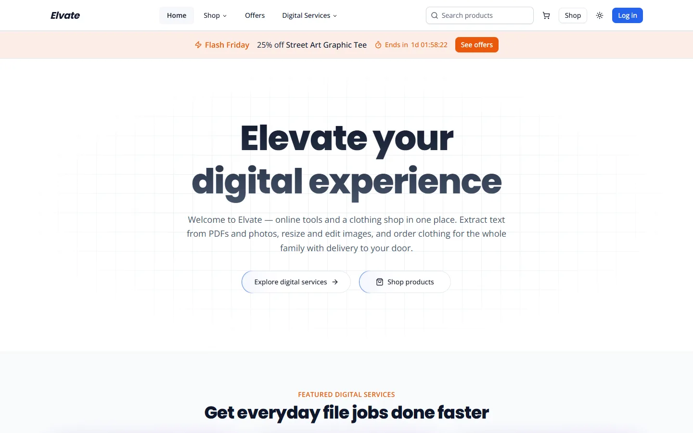</picture>
    </td>
    <td width="50%"><b>Shop</b><br>
      <picture><source media="(prefers-color-scheme: dark)" srcset="docs/screenshots/dark/02-shop.webp">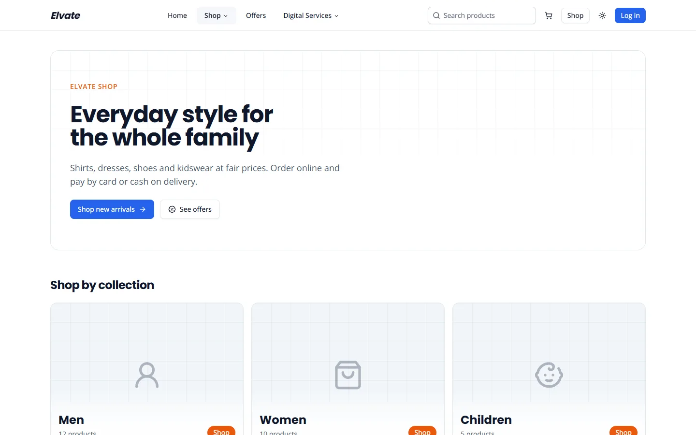</picture>
    </td>
  </tr>
  <tr>
    <td><b>Product</b><br>
      <picture><source media="(prefers-color-scheme: dark)" srcset="docs/screenshots/dark/07-product.webp">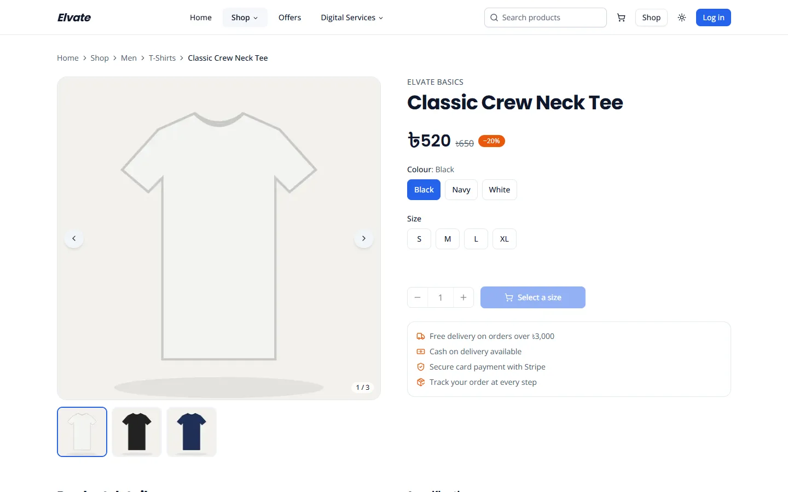</picture>
    </td>
    <td><b>Checkout</b><br>
      <picture><source media="(prefers-color-scheme: dark)" srcset="docs/screenshots/dark/19-checkout.webp">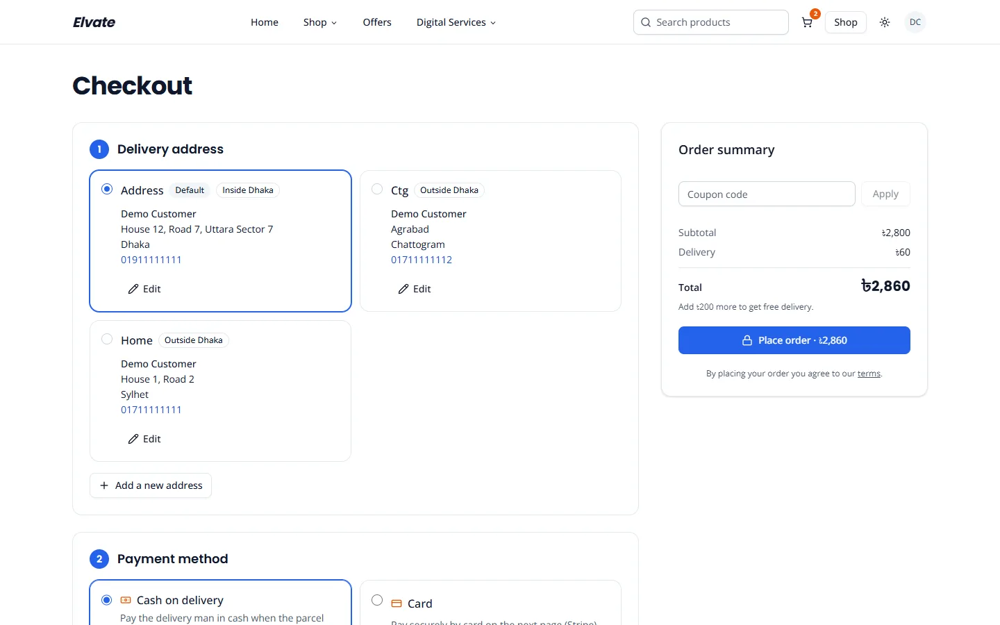</picture>
    </td>
  </tr>
  <tr>
    <td><b>Order tracking</b><br>
      <picture><source media="(prefers-color-scheme: dark)" srcset="docs/screenshots/dark/22-order-details.webp">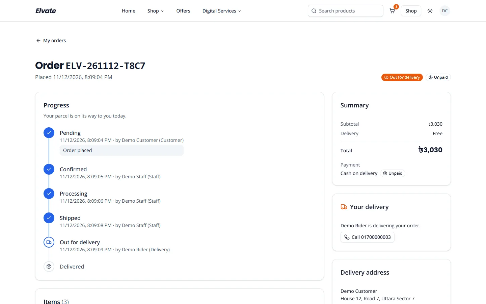</picture>
    </td>
    <td><b>Signed-in devices</b><br>
      <picture><source media="(prefers-color-scheme: dark)" srcset="docs/screenshots/dark/25-settings-security.webp">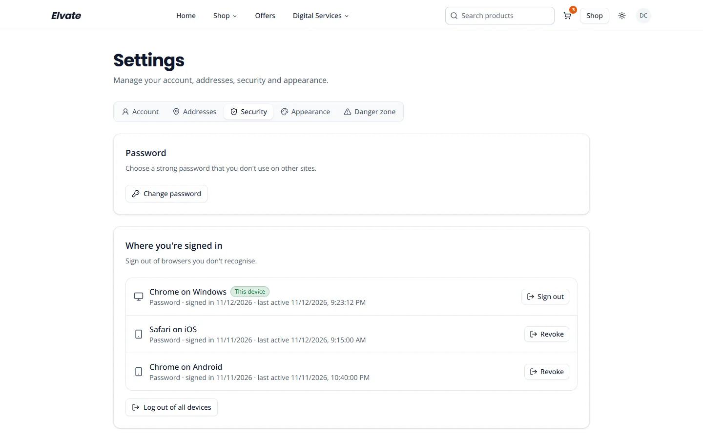</picture>
    </td>
  </tr>
  <tr>
    <td><b>Image to text</b><br>
      <picture><source media="(prefers-color-scheme: dark)" srcset="docs/screenshots/dark/32-image-to-text.webp">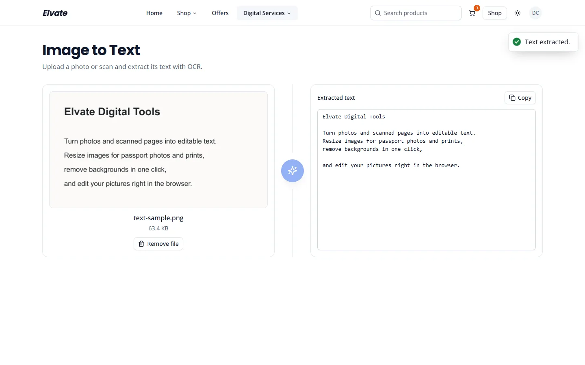</picture>
    </td>
    <td><b>Admin dashboard</b><br>
      <picture><source media="(prefers-color-scheme: dark)" srcset="docs/screenshots/dark/36-admin-dashboard.webp">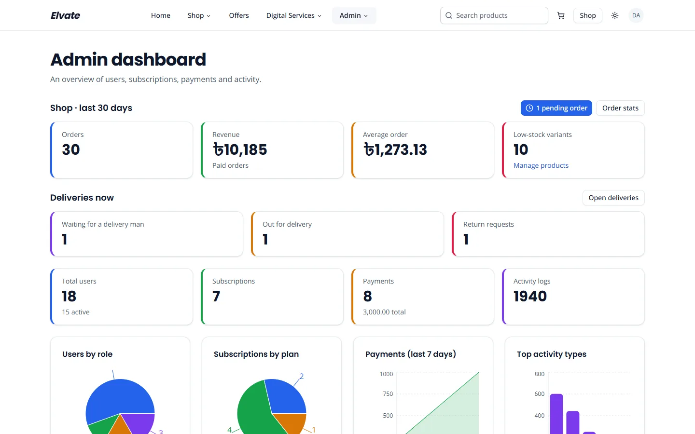</picture>
    </td>
  </tr>
  <tr>
    <td><b>Deliveries board (admin / staff)</b><br>
      <picture><source media="(prefers-color-scheme: dark)" srcset="docs/screenshots/dark/48-admin-deliveries.webp">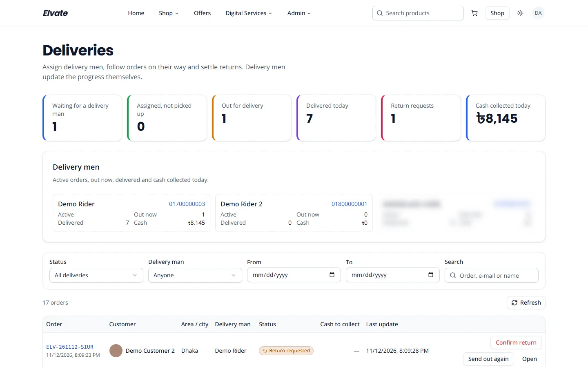</picture>
    </td>
    <td><b>Delivery man</b><br>
      <picture><source media="(prefers-color-scheme: dark)" srcset="docs/screenshots/dark/60-delivery.webp">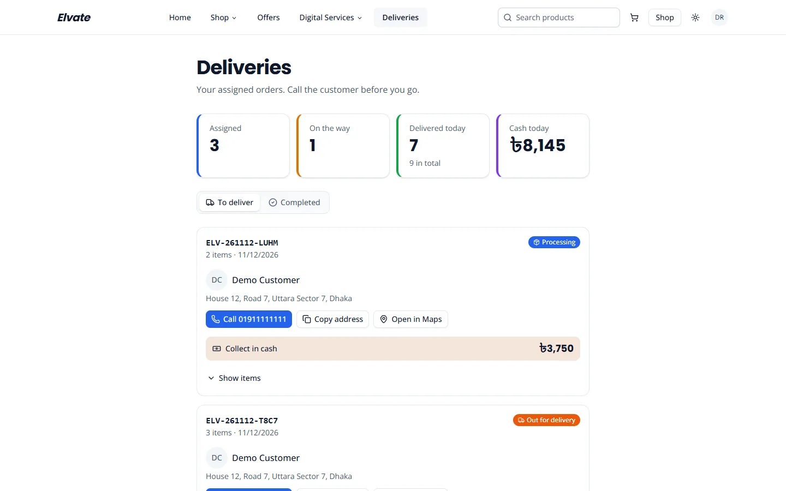</picture>
    </td>
  </tr>
</table>

---

## Table of contents

- [Features](#features)
- [What each role can do](#what-each-role-can-do)
- [Tech stack](#tech-stack)
- [How it works](#how-it-works)
- [Security](#security)
- [Getting started](#getting-started)
- [Environment variables](#environment-variables)
- [Scripts and tests](#scripts-and-tests)
- [Project structure](#project-structure)
- [Design system](#design-system)
- [Deployment](#deployment)
- [Known limitations](#known-limitations)
- [Author](#author) · [License](#license)

---

## Features

### Shopping
- Shop pages for **Men**, **Women** and **Children**, plus every sub-category
- Filters (sub-category, price, size, colour, brand, on sale, in stock) and sorting, kept in the URL so a result can be shared
- Product pages with an image gallery, size and colour choice, stock hints, specifications, **customer reviews** and related products
- **Search** in the navigation bar with live suggestions
- **Offers** page with flash-sale countdowns and copyable coupon codes
- A **cart** that works before signing in and is merged into the account after login

### Checkout and orders
- One-page checkout: pick or add an address, apply a coupon, see the delivery fee (inside / outside Dhaka, free above a threshold)
- Pay by **cash on delivery** or **card (Stripe Checkout)**; an unpaid card order can be paid later from the order page
- **My orders** with a status timeline (who moved the order and when), cancel before it is prepared, review delivered items

### Account and sign-in
- Sign up with e-mail verification; log in with e-mail and password, **Google** or **face login**; forgot / reset password by e-mail or SMS code
- **Face login**: set up from the profile with your profile picture, your password and a short camera check; logging in asks for a quick
  liveness move (turn your head or blink). It can be removed at any time
- Profile with photo upload and crop, phone verification by SMS code
- **Settings**: address book, signed-in devices (sign out one or all), change password, theme, delete account
- Personal activity log, subscription details and payment history

### Digital tools (subscription)
- **PDF to text**, **image to text (OCR)**, **image resize** with presets, an **image editor** (crop, rotate, brightness, contrast, blur,
  grayscale, flip) and **background removal**
- Monthly, 6-month and yearly plans through Stripe Checkout

### Shop management (staff and admins)
- Orders: search and filters, status changes, delivery-man assignment, notes, statistics
- **Deliveries board**: waiting / assigned / out for delivery / delivered today / return requests, cash collected per delivery man
- Products (photos, variants, stock, visibility), the category tree, and review moderation

### Delivery (delivery men)
- A phone-friendly list of assigned orders with the address, a call button, maps link and the cash to collect
- Mark *out for delivery*, *delivered* (cash collected) or *return requested*; a separate list of completed deliveries

### Administration (admins)
- **Dashboard** with charts for orders, revenue, users, subscriptions, payments and activity
- Users and roles (export the list as PDF), coupons and flash sales, payments, subscriptions, activity logs with filters and CSV export
- **Feature switches**: turn SMS codes and face login on or off for the whole site; the pages adapt to the switch
- A logged **correction** when a delivery man cannot update an order himself

### Everywhere
- Light and dark theme, responsive layout, keyboard and screen-reader friendly components, loading skeletons and empty states
- After login every role lands on its own page: admins on the dashboard, staff on orders, delivery men on their deliveries
- SEO: page metadata, `sitemap.xml`, `robots.txt`, an Open Graph image and structured product data

---

## What each role can do

| Role | Lands on | Can use |
|---|---|---|
| **Customer** | home (or the page that asked them to log in) | Shop, cart, checkout, own orders and reviews, subscriptions and digital tools, profile and settings |
| **Staff** | `/admin/orders/view` | Everything a customer can, plus orders, deliveries board, products, categories and reviews |
| **Delivery man** | `/delivery` | Only the orders assigned to him; he updates their delivery progress |
| **Admin** | `/admin/dashboard` | Everything staff can, plus users and roles, offers, payments, subscriptions, activity logs, settings and delivery corrections. Admins manage deliveries but do not perform them |

<details>
<summary><b>All pages and who can open them</b></summary>

| Area | Pages | Who |
|---|---|---|
| Public | `/`, `/shop`, `/shop/men`, `/shop/women`, `/shop/children`, `/shop/category/[slug]`, `/shop/product/[slug]`, `/search`, `/offers`, `/cart`, `/digitalServices`, `/about`, `/contact`, `/terms` | everyone |
| Sign-in | `/login`, `/signup`, `/verifyRegistration`, `/google`, `/faceLogin`, `/forgotPassword`, `/resetPassword` | signed-out visitors |
| Account | `/profile`, `/settings`, `/activity`, `/checkout`, `/orders`, `/orders/[id]`, `/orders/success` | signed-in users |
| Subscription | `/subscription`, `/subscription/details`, `/payment/success`, `/payment/cancel`, `/payment/history` | signed-in users |
| Digital tools | `/digitalServices/pdfToText`, `imageToText`, `imageResize`, `editImage`, `backgroundRemove` | signed-in users (a subscription is needed to run a tool) |
| Shop management | `/admin/orders/*`, `/admin/deliveries`, `/admin/products/*` (incl. categories), `/admin/reviews` | staff and admins |
| Administration | `/admin/dashboard`, `/admin/users/*`, `/admin/offers/*`, `/admin/subscription/*`, `/admin/payment/*`, `/admin/activity/*`, `/admin/settings` | admins |
| Delivery | `/delivery` | delivery men |

</details>

---

## Tech stack

| Area | Technology |
|---|---|
| Framework | [Next.js 15](https://nextjs.org) (App Router), React 19, TypeScript |
| Styling | Tailwind CSS 4, shadcn/ui on Radix UI, `next-themes` (light / dark) |
| Icons and motion | lucide-react, Motion (respects *reduce motion*) |
| Data | axios with automatic session refresh; server components and ISR for the public catalogue |
| Charts | Recharts |
| Forms and UI | input-otp, react-easy-crop, react-hot-toast |
| Session | `jose` (reads the encrypted session cookie in middleware, server-only) |
| Face login | face-api.js in the browser (face position and liveness prompts) |
| Export | jsPDF, html2canvas |
| Tests | Node.js built-in test runner |

---

## How it works

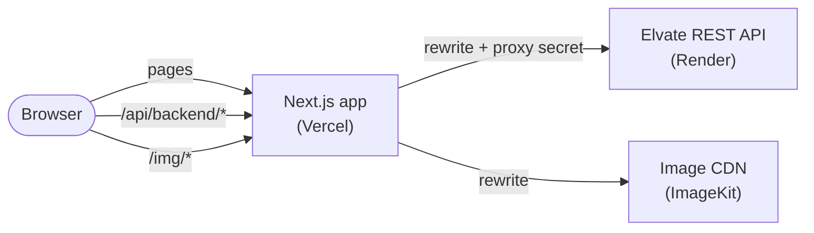

- **One address for everything.** The browser calls the API at `/api/backend/*` and `next.config.ts` forwards it to the backend. The
  session cookie is therefore first-party to this website and works in every browser.
- **Page protection.** `src/middleware.ts` decrypts the session cookie (same `COOKIES_SECRET` as the backend) and sends visitors to
  `/login?next=…` or `/403` depending on their role.
- **Real client IP for rate limits.** The middleware adds a shared secret and the visitor's IP to every proxied API call, so the backend
  can trust that IP and nobody can fake it by calling the API directly.
- **Private photos.** Shop photos load from `/img/*` and profile photos from `/api/backend/media/*`, so the image host's address never
  reaches the browser and profile photos are never public.
- **Automatic refresh.** `src/lib/authAxios.ts` refreshes an expired session once, shared by every waiting request, and retries it.
- **Fast public pages.** Shop, product and offers pages are server-rendered and cached for a short time; interactive parts run in the browser.

---

## Security

- Session tokens stay in an **httpOnly, encrypted cookie** and are never passed to client components (`server-only` session helpers)
- Security headers on every route: `X-Frame-Options`, `X-Content-Type-Options`, `Referrer-Policy`, `Permissions-Policy`
  (camera only for this site) and a **Content Security Policy** (report-only while it is being tightened)
- Safe redirects after login (`?next=` only accepts paths on this site), URL parts are always encoded
- Password rules shown on every password form; generic error messages that do not reveal whether an account exists
- Face login takes fresh photos for every attempt and asks for a liveness move (turn your head or blink); the reference photo stays private on the server

The server-side protections (rate limits, login lockout, upload checks and more) are listed in the
[backend README](https://github.com/azminur2856/Elvate-Rest-Api#security).

---

## Getting started

### Prerequisites
- **Node.js 22** and npm
- The [Elvate REST API](https://github.com/azminur2856/Elvate-Rest-Api) running locally (default `http://localhost:8000`).
  Its `npm run seed` script loads demo categories, products and offers.

### Install and run

```bash
git clone https://github.com/azminur2856/elvate-frontend.git
cd elvate-frontend
npm install
cp .env.example .env      # then fill in the values (see below)
npm run dev               # http://localhost:3000
```

In Stripe test mode, pay with the test card `4242 4242 4242 4242`, any future date and any CVC.

---

## Environment variables

<details>
<summary><b>Show the variables</b> (copy <code>.env.example</code> to <code>.env</code>)</summary>

| Variable | Purpose |
|---|---|
| `BACKEND_URL` | Server-only. Where `/api/backend/*` is forwarded: `http://localhost:8000` locally, the API URL in production |
| `NEXT_PUBLIC_BACKEND_URL` | Base URL the browser uses for API calls. Keep it `/api/backend` |
| `NEXT_PUBLIC_FRONTEND_URL` | Public URL of this app |
| `COOKIES_SECRET` | Base64 32-byte key to read the session cookie. **Must match the backend** |
| `PROXY_SHARED_SECRET` | Server-only. Sent with every proxied API call so the backend trusts the client IP. **Must match the backend**; empty locally if the backend has none |
| `IMAGEKIT_URL_ENDPOINT` | Server-only. Image CDN address that `/img/*` is served from |

Generate secrets with `openssl rand -base64 32`. Never commit `.env`, and never prefix a secret with `NEXT_PUBLIC_`.

</details>

---

## Scripts and tests

| Command | What it does |
|---|---|
| `npm run dev` | Development server on port 3000 |
| `npm run build` | Production build (ESLint runs during the build) |
| `npm run start` | Serve the production build |
| `npm run lint` | ESLint |
| `npm test` | Unit tests for the helpers in `src/lib` (redirect safety, password rules, photo URLs, face metrics) |

---

## Project structure

<details>
<summary><b>Show the folders</b></summary>

```
src/
├── app/            routes (App Router): a server page.tsx (metadata) + a client …Client.tsx
│   ├── (auth)/     login, sign-up, Google, face login, password reset
│   ├── (user)/     profile, activity, subscription
│   ├── admin/      dashboard, users, products, orders, deliveries, offers, reviews, payments, activity, settings
│   ├── delivery/   delivery man page
│   ├── shop/       shop, categories, product pages
│   └── …           cart, checkout, orders, offers, search, settings, digitalServices, sitemap, robots
├── components/
│   ├── ui/         shadcn/Radix primitives (button, dialog, data table, …)
│   ├── shop/       product card, filters, gallery, reviews, countdown
│   ├── cart/       cart provider
│   ├── orders/     order summary, status timeline
│   ├── settings/   feature flags, devices, face login, delete account
│   ├── admin/      stat and chart cards
│   ├── tools/      digital-tool building blocks
│   ├── navbar/     desktop and mobile navigation, role-based menus
│   └── …           address, auth, forms, home, modal, footer, shared
├── hooks/          tool upload, debounce, face alignment, …
├── lib/            API client, session, formatting, catalogue fetchers, media URLs
├── types/          shared API types
└── middleware.ts   route protection by role + API proxy headers
```

</details>

---

## Design system

- Colours are **semantic tokens** (`--background`, `--brand`, `--success`, `--chart-1…5`, …) defined for light and dark in
  `src/app/globals.css`; components use only these tokens, so both themes stay consistent
- Typography: **Poppins** for headings, **Open Sans** for body text
- Building blocks: `PageShell` (page layout), `DataTable` + `PaginationControls` (tables), `ConfirmDialog` (destructive actions),
  `FormField` / `FormMessage` (forms)

---

## Deployment

Deployed on **Vercel** from the `main` branch.

| Setting | Value |
|---|---|
| Build | default (`next build`) |
| Environment | `BACKEND_URL` (the API URL), `NEXT_PUBLIC_BACKEND_URL=/api/backend`, `NEXT_PUBLIC_FRONTEND_URL`, `COOKIES_SECRET` and `PROXY_SHARED_SECRET` (both the same as the API), `IMAGEKIT_URL_ENDPOINT` |

---

## Known limitations

- The API runs on Render's free tier: the first request after a quiet period can take about 50 seconds while the server wakes up
- SMS codes are switched off by default (they need SMS credits); e-mail works for everything
- Face login needs a camera and good light, and it can be switched off by an admin
- The Content Security Policy is in report-only mode for now

---

## Author

**Azminur Rahman** · [@azminur2856](https://github.com/azminur2856)

## License

[MIT](LICENSE)
